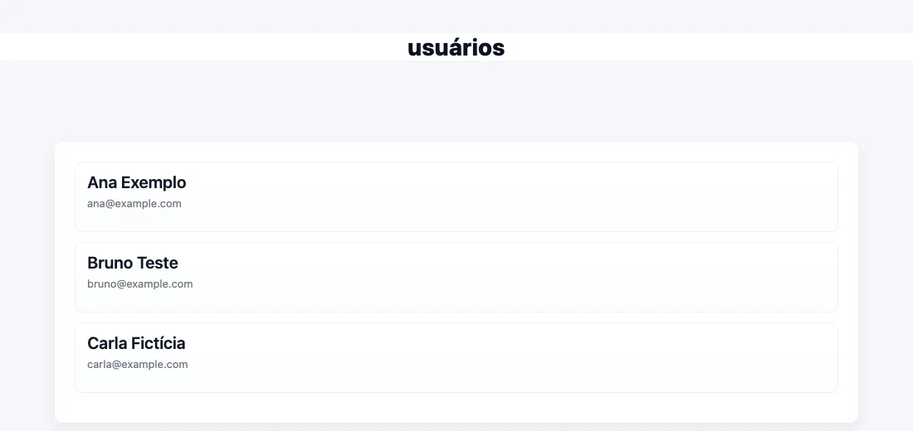
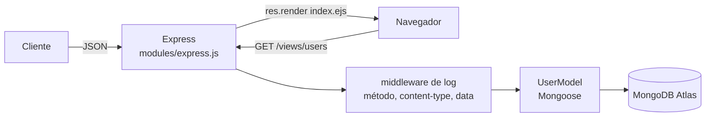

# Bootcamp Node.js

Exercícios de um curso de Node.js: módulos nativos (`http`, `fs`, `path`), uma classe simples e, no fim, uma API Express com CRUD de usuários no MongoDB (Mongoose) e uma página server-side em EJS.



## O que tem aqui

| Arquivo | O que pratica |
| --- | --- |
| `modules/http.js` | servidor com o módulo `http` na porta 8081: `/home` (HTML) e `/users` (JSON fixo no código) |
| `modules/fs.js` | criar pasta, escrever, anexar e ler arquivo com `fs` (gera `modules/test/teste.txt`) |
| `modules/path.js` | `basename`, `dirname`, `extname`, `parse`, `join` |
| `person.js` | classe `Person` com `SayMyName()` |
| `modules/express.js` | API Express + middleware de log + rotas de usuários + view EJS |
| `src/database/connect.js` | conexão Mongoose com o cluster MongoDB Atlas do curso |
| `src/models/user.model.js` | schema `User` (`firstName`, `lastName`, `email`, `password`, todos obrigatórios) |
| `src/views/` | `index.ejs` + partials `head.ejs` (estilos) e `navbar.ejs` |

`index.js` é o ponto de entrada: carrega o `.env`, sobe o Express e conecta no MongoDB. Os outros módulos estão comentados no fim do arquivo; descomente um `require` para rodar o exercício correspondente.

## Como funciona



## Stack

Node.js, Express 5, Mongoose 9, EJS, dotenv, nodemon.

## Como rodar

Pré-requisitos: Node.js 20+ e acesso a um cluster MongoDB Atlas.

```bash
npm install
cp .env.example .env     # preencha DB_USER, DB_PASSWORD e PORT
npm run start:dev        # nodemon index.js
```

| Variável | Uso |
| --- | --- |
| `DB_USER` | usuário do MongoDB Atlas |
| `DB_PASSWORD` | senha do MongoDB Atlas |
| `PORT` | porta do Express (não há valor padrão; sem ela o servidor escolhe uma porta aleatória) |

O host do cluster está fixo em `src/database/connect.js` (`mongodb+srv://...@cluster0.oefyncw.mongodb.net`). Para usar outro banco, troque a `uri` nesse arquivo.

Os exercícios avulsos rodam direto: `node modules/http.js` (porta 8081), `node modules/fs.js`, `node modules/path.js`.

## API

| Método | Rota | Descrição | Respostas |
| --- | --- | --- | --- |
| GET | `/users` | lista usuários | 200, 500 |
| GET | `/users/:id` | busca por ObjectId (`null` se não existir) | 200, 404 (id inválido) |
| POST | `/users` | cria usuário | 201, 500 (validação do Mongoose) |
| PATCH | `/users/:id` | atualiza campos e retorna o documento novo | 200, 500 |
| DELETE | `/users/:id` | remove e retorna o documento apagado | 202, 500 |
| GET | `/views/users` | página HTML com os usuários (EJS) | 200 |

```bash
curl -X POST http://localhost:3000/users -H "Content-Type: application/json" \
  -d '{"firstName": "Ana", "lastName": "Exemplo", "email": "ana@example.com", "password": "senha123"}'
```

Erros voltam como texto puro com a mensagem do Mongoose. A senha é gravada e devolvida sem hash: é um exercício, não um cadastro real.

Documentação da API:

- OpenAPI 3 (escrito à mão a partir das rotas): [`docs/openapi.yaml`](docs/openapi.yaml). Para visualizar: cole em [editor.swagger.io](https://editor.swagger.io) ou rode `npx @redocly/cli@1.34.3 preview-docs docs/openapi.yaml`.
- Postman: importe [`docs/postman/Node_Bootcamp.postman_collection.json`](docs/postman/Node_Bootcamp.postman_collection.json). `baseUrl` vem como `http://localhost:3000`; "Criar usuário" salva o `_id` em `userId`.

## Estrutura

```
index.js                  # entrada: dotenv, Express, conexão MongoDB
person.js
modules/
├── express.js            # API + view
├── http.js  fs.js  path.js
└── test/teste.txt        # gerado por fs.js
src/
├── database/connect.js
├── models/user.model.js
└── views/                # index.ejs + partials
docs/                     # openapi.yaml, coleção Postman, imagem
```

## Testes

Não há testes automatizados (`npm test` só imprime a mensagem padrão do npm).

## Licença

ISC (campo `license` do `package.json`).
